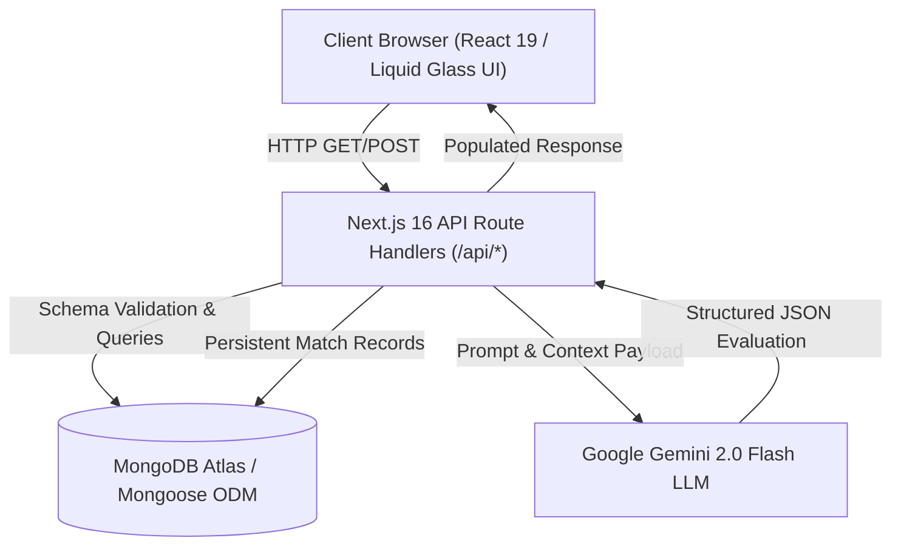

# BWCON — Corporate-Startup Matchmaking Platform

[](https://nextjs.org/)
[](https://www.typescriptlang.org/)
[](https://ai.google.dev/)
[](https://www.mongodb.com/)
[](https://tailwindcss.com/)
[](LICENSE)

An ultra-premium, AI-driven corporate venture matchmaking platform designed to pair corporate enterprise challenges with disruptive startups. Powered by Next.js 16 (App Router), Google Gemini 2.0 Flash LLM, MongoDB Mongoose, and an Apple macOS Liquid Glass aesthetic.

---

## 🌟 Key Capabilities

1. **Multi-Page Application Architecture:**
   - **Landing Page (`/`):** Hero showcase, innovation ecosystem overview, metrics, and call-to-actions.
   - **Startup Registration (`/startups`):** Deep venture data capture (technologies, maturity stage, funding, team size, solution scope).
   - **Corporate Challenge Entry (`/challenges`):** Enterprise problem framing (budget, required stack, preferred startup stages, deliverables).
   - **Matchmaking Dashboard (`/dashboard`):** High-end glass cards, animated SVG circular compatibility score indicators, expandable accordions (Pros, Cons, Strategic Fit, Estimated Financials).
   - **Interactive System Architecture & Living Docs (`/system`):** Interactive visual topology graph and dual-layer deep living documentation (Non-Technical & Technical Deep Dive) with live telemetry.

2. **Google Gemini Generative AI Evaluator:**
   - Autonomous compatibility evaluation based on strategic alignment, technical competence, and budget viability.
   - Structured JSON output guaranteed with automatic markdown sanitization and validation.
   - Generates score (0-100), itemized advantages (pros), risk considerations (cons), strategic synthesis, and estimated engagement cost.

3. **Apple macOS "Liquid Glass" Aesthetic:**
   - Multi-layered frosted glass panels (`backdrop-blur-2xl`, `bg-white/10`).
   - Dynamic fluid mesh-gradient backgrounds with subtle ambient glows.
   - Animated rotating gradient borders.
   - 60fps Framer Motion micro-interactions, page transitions, and expandable spring accordions.

---

## 🛠️ Architecture & Tech Stack



- **Frontend:** Next.js 16.4 App Router, React 19, Tailwind CSS v4, Framer Motion.
- **Backend:** Next.js Route Handlers with Mongoose ODM connection singleton caching.
- **AI Engine:** Google Gemini 2.0 Flash via `@google/generative-ai`.
- **Testing:** Jest, ts-jest, Next.js test environment (40+ passing unit & integration tests).
- **Deployment Target:** Render.com (via `render.yaml`) & GitHub.

---

## 🚀 Getting Started

### 1. Prerequisites
- Node.js 20+
- MongoDB instance (Local or MongoDB Atlas)
- Google Gemini API Key ([Get one at Google AI Studio](https://aistudio.google.com/))

### 2. Installation
```bash
git clone https://github.com/Doorandish/BWCON.git
cd BWCON
npm install
```

### 3. Environment Configuration
Create a `.env.local` file by copying the example:
```bash
cp .env.example .env.local
```

Fill in your secrets:
```env
MONGODB_URI=mongodb+srv://<username>:<password>@cluster.mongodb.net/bwcon?retryWrites=true&w=majority
GEMINI_API_KEY=your_actual_gemini_api_key_here
```

### 4. Run Development Server
```bash
npm run dev
```
Navigate to [http://localhost:3000](http://localhost:3000).

---

## 🧪 Automated Testing

Run the automated Jest test suite covering models, API endpoints, and mocked Gemini parsing:
```bash
npm test
```

Sample output:
```
PASS __tests__/api/api.test.ts
PASS __tests__/services/gemini.test.ts
PASS __tests__/models/Match.test.ts
PASS __tests__/models/CompanyChallenge.test.ts
PASS __tests__/models/Startup.test.ts

Test Suites: 5 passed, 5 total
Tests:       40 passed, 40 total
```

Pre-commit git hooks are managed via Husky, blocking any commit that fails tests.

---

## 🚢 Render.com Deployment Guide

This repository includes a production-ready `render.yaml` blueprint.

### Automatic Blueprint Deployment
1. Push your repository to GitHub.
2. Log in to your [Render.com Dashboard](https://dashboard.render.com/).
3. Click **New +** → **Blueprint**.
4. Connect the `BWCON` repository.
5. In the **Environment Variables** dashboard on Render, specify:
   - `MONGODB_URI`: Your MongoDB connection string.
   - `GEMINI_API_KEY`: Your Google Gemini API Key.
6. Click **Apply**. Render will automatically build (`npm install && npm run build`) and start (`npm start`) the application.

---

## 📄 License
MIT © BWCON Platform
